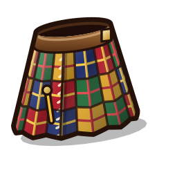
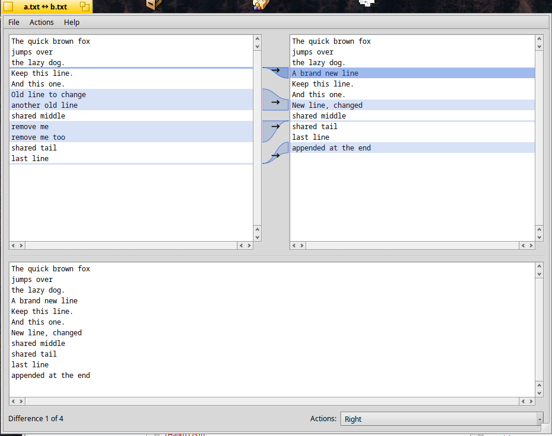
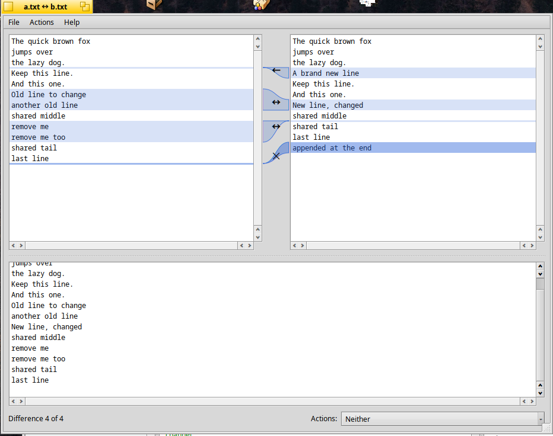

# PatchWork

A small native Haiku compare-and-merge tool for two files, modeled on Apple's FileMerge. It shows both files side by side with each difference linked across a center gutter, lets you pick which side wins for every difference, and saves the merged result. It can also save a `diff -u` patch and apply patches.







## Build

On Haiku, with the development tools installed:

```sh
make
```

This uses the standard makefile-engine. The binary lands in `objects.*/PatchWork`, with the signature, version, file types and vector icon from `PatchWork.rdef` bound in.

## Usage

- **Compare window.** Started without files, PatchWork opens a small Compare Files window with Left and Right fields. Type a path, use Browse…, or drop a file from Tracker on a field (dropping two files fills both). Compare (the default button) opens a merge window for the pair. **File > Compare Files…** (Alt+N) in any merge window brings it back.
- **Opening files directly.** Select two files in Tracker and open them with PatchWork, or run `PatchWork left right` in Terminal; a merge window opens straight away. Several merge windows can be open at once. The app quits when its last window closes.
- **Identical files and errors.** Identical files show "The files are identical" and no window. If diff fails (missing file, binary files, a folder) its message is shown in an alert.
- **Merge window.** The title is `left ↔ right`. The top half shows the left and right files read-only with every difference shaded; the gutter between them draws a band from each difference's lines on the left to its lines on the right, with an arrow for its choice: ← left, → right, ↔ both, ✕ neither. The selected difference is shaded darker. Scrolling either pane scrolls the other, kept aligned across differences. The bottom half is the merge pane: the merged result, editable by hand. A split bar sits between the halves. The status line shows "Difference 3 of 7" and an Actions popup with the selected difference's choice.
- **Choosing.** Every difference starts as Right, as in FileMerge. **Actions** has Next Difference (Alt+Down), Previous Difference (Alt+Up), Choose Left (Alt+Left), Choose Right (Alt+Right), Choose Both (Left First), Choose Both (Right First) and Choose Neither. Clicking a shaded range in either pane, or a band in the gutter, selects that difference, and selecting scrolls all three panes to it. Changing a choice rebuilds the merge pane; if you edited the merge pane by hand since it was last built, PatchWork asks before discarding those edits.
- **File > Save Merge…** (Alt+S) opens a save panel set to the right file's folder and name and writes exactly the merge pane's text. An overwritten file keeps its MIME type; a new file gets the right file's type, or `text/plain`. Closing a merge window whose merge differs from what was last saved asks Save / Don't Save / Cancel.
- **File > Save Patch…** writes `diff -u left right` and sets its MIME type to `text/x-patch`.
- **File > Apply Patch…** asks for a patch file, then for the file to patch, runs `patch -N target patchfile` and shows patch's output. `-N` makes patch refuse an already-applied patch instead of offering to reverse it.
- **File > Close** (Alt+W), **File > Quit** (Alt+Q), **Help > About PatchWork**.

`diff` and `patch` are run with fork/execvp, never through a shell, so file names with spaces, quotes or `$` are passed through unchanged. Files are compared line by line in diff's normal output format; the merge is built from the files' own bytes, so choosing Left (or Right) everywhere reproduces that file exactly, including CRLF line ends and a missing final newline.

## Layout

- `src/` — `App.cpp` (BApplication: Tracker refs and argv, window count, Apply Patch, About), `CompareWindow.*` (the opener), `MergeWindow.*` (panes, gutter, merge pane, menus, saving), `DiffModel.*` (pure C++, no Be API: runs diff, parses its normal output into hunks, builds the merge, maps lines between sides), `RunProcess.*` (fork/execvp with both pipes drained), `AppMessages.h` (app-wide message codes).
- `PatchWork.rdef` — app signature `application/x-vnd.PatchWork`, `B_SINGLE_LAUNCH`, version 1.0.0, accepted types `text/plain` and `text/x-patch`, and the HVIF vector icon.
- `icon/make_hvif.py` — draws the icon (a pleated patchwork kilt in BeOS style) from one geometry model and writes both `icon/PatchWork.svg` and the `vector_icon` block in `PatchWork.rdef`. Edit the script, not its outputs, then run `python3 icon/make_hvif.py`.
- `sample/` — `a.txt`/`b.txt`, two small files with every kind of difference, and `long_a.txt`/`long_b.txt`, 200 lines with differences spread out, for trying scrolling.
- `tests/` — checks that run anywhere with a C++17 compiler and Python 3.

## Tests

These run on macOS or Linux as well as Haiku:

```sh
clang++ -std=c++17 -Isrc tests/DiffModelTest.cpp src/DiffModel.cpp src/RunProcess.cpp -o /tmp/model && /tmp/model
clang++ -std=c++17 -Isrc tests/RunProcessTest.cpp src/RunProcess.cpp -o /tmp/run && /tmp/run
python3 tests/test_hvif.py
```

`DiffModelTest` checks the diff parser (add, delete, change, several hunks, content that looks like commands, a missing final newline on either side, malformed output), the merge for every choice, the line mapping used for scrolling, and round-trips through the real `diff`: for tricky pairs (an empty file, no final newline, CRLF lines, lines starting with `<`, `>`, `---`) choosing all Left gives the left file byte for byte and all Right the right file. `test_hvif.py` decodes the generated HVIF with an independent decoder modeled on Haiku's `FlatIconImporter`, checks every style, path point and stroke round-trips, and checks that `PatchWork.rdef` is up to date with the script.

## License

MIT. See [LICENSE](LICENSE).
